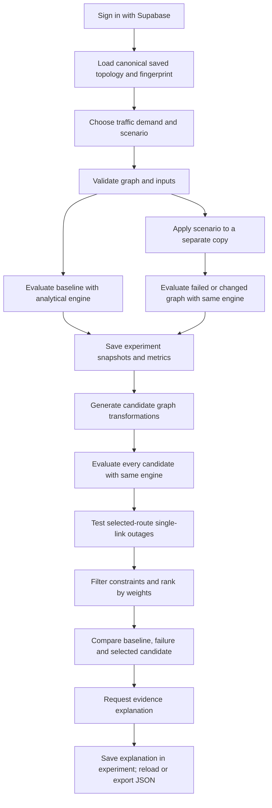

# Network Failure Simulation & Modernization: detailed workflow and roadmap

> **Subsequent implementation:** [NSGA-II, operator decisions and AI evidence validation](optimization-decision-milestones.md) now extends this historical milestone report. Genuine AI and signed-in browser verification remain explicit external gates.

Reviewed against the checked-out repository on **2026-10-17**. This is a comprehensive implementation map, not a claim that every future milestone is complete. No application code or database data was changed to produce this document.

> **Upgrade update (2026-10-17):** [Milestones A/B implementation and verification](graph-analysis-milestones.md) supersedes the earlier graph/anomaly status below. NetworkX/Louvain and a transparent untrained rule baseline now operate; NSGA-II/Pareto selection remain unimplemented. Engine 2.1 also corrects the traffic-increase baseline. The open export remains an engine 2.0 historical artifact.

## 1. What the page actually does

The page answers: given a saved network graph, an explicit traffic demand and a scenario, what service remains available, which modeled transformations are feasible under declared constraints, and which candidate best matches the user's priorities?

The workflow is:



Candidate graphs remain inside experiments. This flow does not deploy a network or overwrite the canonical saved topology.

### Meaning of “Analytical simulation · provenance: simulated”

- **Analytical:** graph algorithms and mathematical approximations calculate the results.
- **Simulated:** the values are model outputs, not measurements captured from devices.
- The engine is deterministic for the same graph, demand, scenario and criteria. New experiment IDs can differ even when calculated metrics match.
- Playback animates calculated events and routes. It sends no packets and models no real-time failover duration.
- There is no required Mininet, SSH, VM, Open vSwitch or Containerlab dependency.

## 2. Your currently open experiment

Inspected export: `experiment-abaae93e-09b9-402f-bff1-eddc78a0459e.json`.

| Item | Value read from the export |
| --- | --- |
| Engine | `analytical-network-sim/2.0` |
| Graph | 8 nodes, 14 connections |
| Scenario | Link failure |
| Failed connection | 2960-24TT Switch to Smart Load Balancer |
| Demand | PC2 to Server-PT, 100 Mbps, 60 seconds, 1500-byte packets |
| Baseline route | PC2 → 2960-24TT Switch → Server-PT |
| Route after failure | The same route |
| Failed connection on baseline route? | No |
| Modernization proposal/candidates | Not present in this export |
| Modernized metrics | Not present |
| Explanation | Not present |

| Metric | Baseline | After failure |
| --- | ---: | ---: |
| Active / failed connections | 14 / 0 | 13 / 1 |
| Delivered throughput | 100 Mbps | 100 Mbps |
| Mean latency | 2.026667 ms | 2.026667 ms |
| End-to-end loss | 0% | 0% |
| Reachable nodes | 8 / 8 | 8 / 8 |
| Selected path capacity | 1000 Mbps | 1000 Mbps |

**Interpretation:** the fault reduces available connectivity infrastructure, but does not affect this demand's existing route or the reported reachability. The export does not demonstrate rerouting, because the selected route did not change. It also does not establish the impact on other traffic demands, which were not evaluated.

The latency components are 2 ms propagation + 0.024 ms serialization + approximately 0.002667 ms queueing. Estimated packet counts are 500,000 sent, 500,000 delivered and zero dropped. None are measured packet counters. All 14 connections have unconfigured packet-loss values, so the engine's explicit zero-loss assumption contributes to the reported 0% loss; that is not evidence that the physical network has zero loss.

Modernization and AI cannot be inferred from this file: those fields are absent/null, not successful results with zero values. To obtain those artifacts, generate/evaluate strategies and request an explanation, then reload/export the updated experiment.

The API's `status: completed` means the requested calculation completed. After the initial run, it does not mean modernization, AI and physical implementation have all happened. Database experiment status distinguishes `failure_simulated` from `modernized`; explanation presence is a separate field.

## 3. What every part of the page represents

| Page section/control | Actual behavior |
| --- | --- |
| Experiment history | Lists the latest 50 owner-scoped saved experiments and reloads their stored snapshots, metrics and latest explanation. |
| Scenario selector | Selects an existing mutation type and its required targets/parameters. |
| Traffic source/destination | Defines the one demand evaluated by this model; these must be different saved nodes. |
| Offered traffic | Desired ingress rate, not guaranteed delivery. |
| Reporting duration | Converts steady-state rates into expected packet counts; it is not a time-stepped simulation duration. |
| Run Simulation | Loads/checks saved topology, evaluates baseline and scenario copies and persists an experiment. |
| Baseline graph | Original graph snapshot used by the experiment. Baseline metrics become available when evaluated. |
| Failure playback | Displays fault events and the calculated surviving route, or a no-route event. |
| Generate Solution Simulation | Evaluates candidate transformations with default criteria and persists the selected proposal plus all candidate results. |
| Weights, budget and permissions | Re-evaluates/ranks supported candidates using explicit preferences and hard constraints. |
| Candidate table/inspection | Shows each actual candidate graph, its independently calculated metrics, score, changes and stress-test evidence. |
| Three-Way Comparison | Compares baseline, failed/changed graph and selected candidate using the same effective demand. |
| Explain evidence and trade-offs | Sends computed experiment evidence to the optional AI service, or returns an explicitly deterministic explanation. |
| Export JSON | Downloads the current experiment response; an earlier downloaded file does not update automatically. |
| Model assumptions | Identifies defaults, mathematical assumptions and unsupported effects. |

Red means a disabled/failed connection remains unavailable. Green emphasizes the calculated operational route; amber indicates modeled congestion, blue indicates the current playback step, and gray represents operational connections outside the selected route. The actual path is also listed by node and connection IDs. A candidate with no path does not receive an invented alternative.

## 4. Canonical topology and input validation

`network_nodes` and `network_connections` are the canonical editable Supabase topology. Pydantic models define the API graph; generated TypeScript types and JSON Schema keep the frontend contract aligned. React Flow adapters preserve node/link identifiers, positions and configuration.

The graph represents identity/version, ownership and available timestamps; nodes with device type, hostname/model, state, interfaces, addressing and optional resources; and connections with endpoints, optional interface references, capacity, delay, loss, cable type, status and metadata.

Supported device identifiers include `router`, `switch`, `server`, `pc` (workstation), `access_point`, `hub` and `load_balancer`.

Validation covers duplicate IDs, missing endpoints, invalid interface references, self-links, invalid or nonfinite numbers, IPv4 addresses, subnet masks, prefix agreement, gateways and active-address conflicts. Resource values are retained without pretending that device processing performance is modeled.

Limits/defaults relevant to the simulation API:

| Input | Rule |
| --- | --- |
| Graph size | At most 500 nodes and 2000 links |
| Offered rate | Greater than zero, at most 1,000,000 Mbps |
| Packet size | 64–65,535 bytes; API default 1500 |
| Reporting interval | 1–86,400 seconds; API default 60 |
| Configured connection capacity | Greater than zero, at most 1,000,000 Mbps |
| Configured propagation delay | Nonnegative, bounded by schema |
| Configured connection loss | 0–100% |
| Missing connection capacity/delay/loss | Explicit analytical defaults: 1000 Mbps / 1 ms / 0% |

Defaults do not overwrite saved configuration and are not measurements. The current page sends a 1500-byte packet assumption; the API supports the documented packet-size range.

## 5. Scenarios: exact current mutations

All mutations operate on a separate graph copy.

| Scenario | Parameters | Current rule | Important limit |
| --- | --- | --- | --- |
| `link_failure` | `link_id` | Marks that connection down. | Another route is used only if the graph contains one. |
| `device_failure` | `node_id` | Marks the node and its incident connections down. | Failing an endpoint can disconnect the demand itself. |
| `traffic_increase` | `factor` | Multiplies the demand; no graph mutation. | Engine 2.1 evaluates the baseline at original load and the scenario/recovery at multiplied load. |
| `bandwidth_change` | `link_id`, `bandwidth_mbps` | Sets the selected capacity. | Route choice or stability can change even when physical links stay active. |
| `redundancy_add` | Source/destination node IDs, optional capacity | Adds a candidate connection with deterministic candidate identity. | It is a proposed link, not an installed cable; delay/loss can require defaults. |
| `segment_isolation` | `node_id` | Disables that node and its incident connections. | Candidate generation does not bypass intentional isolation. |
| `capacity_increase` | `link_id`, `increase_mbps` | Adds capacity to the selected link. | Validated against model capacity limits. |
| `cloud_migration` | `node_id` | Reports a placement-only scenario with no calculated network improvement. | Site, region, geographic delay and cloud networking are not modeled. |

Traffic factors must be positive and at most 1000; the resulting rate must also satisfy demand limits. A non-failure scenario still appears in fields named `failed_topology`/`failed_metrics` for API compatibility; read those as the scenario state.

Engine 2.1 uses a paired original-load baseline for traffic increases. Scenario and recovery candidates use the same increased demand. Older engine 2.0 exports used the same multiplied load for baseline and scenario; their snapshots are unchanged.

## 6. Routing and metrics: what is calculated

### Routing

The graph is undirected and supports one steady-state demand. Dijkstra selects a route minimizing:

`sum(connection propagation delay + packet serialization delay)`

Queueing is estimated after routing, not used to choose a path. Stable ordering resolves ties deterministically. Failed/offline/unavailable devices/connections, down referenced interfaces and console connections cannot forward traffic.

Reachability follows the graph. Addresses and gateways are validated configuration; this is not an IP routing-table, VLAN or firewall simulator. Nonempty static/policy routing or modeled security-rule constraints are rejected as unsupported by the analytical evaluator rather than silently enforced incorrectly.

### Delay

For capacity `C` Mbps, offered load `L` Mbps and mean packet size `B` bytes:

```text
serialization S (ms) = 8B / (1000C)
offered ratio rho    = L / C
mean queue wait Wq   = S * rho / (1 - rho), only when rho < 1
mean path delay     = sum(propagation + serialization + stable queue wait)
```

The M/M/1 approximation assumes Poisson arrivals and exponential service around the configured mean packet size. Real fixed-size packets do not satisfy exponential service, so this is explicitly an approximation. At saturation/overload (`rho >= 1`), queue and total mean latency are null with `queueing_status=unstable`. A disconnected route uses `unreachable`. Null is not zero. Maximum latency remains unsupported because a steady-state mean does not determine a maximum.

### Throughput, loss and utilization

```text
path capacity Cmin       = minimum selected-route connection capacity
achievable pre-loss A    = min(L, Cmin)
configured survival P    = product(1 - connection_loss_pct / 100)
delivered throughput D   = A * P
combined loss fraction   = 1 - (A / L) * P
fluid congestion loss    = 1 - A / L
reserved utilization    = A / C for a selected-route connection
```

An unreachable flow delivers zero. Utilization is the pre-loss reserved rate and stays between 0% and 100%; the separate offered-load ratio can exceed one. Current link congestion flags apply at offered load greater than or equal to capacity. A minimum-capacity route connection can be identified as a bottleneck even while demand remains below its capacity.

This is a conservative reservation model: it does not reduce downstream reservation or queue load after random upstream packet loss. Per-link achieved-rate fields represent pre-loss reserved throughput, not observed forwarding counters. Congestion loss is a fluid excess-demand approximation, not finite-buffer packet-drop simulation.

Estimated packet counts use offered rate, packet size and interval. End-to-end percentages derive from rates, so rounding can slightly differ from floored integer counts. Connectivity percentage means nodes reachable from the demand source, not all-pairs enterprise connectivity. Mean link utilization averages over eligible operational links, including unused zero-load links; that denominator can change after a fault even when the selected route is unchanged.

## 7. Transformation and modernization rules

Here, **transformation** means constructing an alternative graph/configuration. **Modernization** means evaluating and comparing those alternatives under the same engine and demand. Neither term guarantees a physical upgrade or an improvement.

| Candidate family | Current construction |
| --- | --- |
| Retain surviving routes | Deep-copy the failed state without repairing or removing faults. Keep the computed surviving path if one exists. |
| Restore selected failed configuration | If repair is allowed for link/device failures or bandwidth changes, restore only the selected scenario's pre-change state/capacity. Preserve unrelated pre-existing faults. |
| Targeted backup | For link failure without a surviving route, add a candidate connection between the failed link's endpoints using its saved configuration. Original failed link remains down. |
| Targeted replacement | Copy the failed device into a candidate replacement and reconnect saved adjacent devices. Original remains failed; service endpoint identity can map to the replacement. |
| Targeted capacity change | Upgrade supported bottleneck links; usually aim for the greater of twice existing capacity and 125% of offered rate, bounded by the capacity limit. Bandwidth-change recovery can restore baseline capacity. |
| Dedicated service path | When new links are allowed and endpoints operate, propose a direct source/destination connection at 125% of demand, bounded by the model limit; missing delay/loss are explicit assumptions. |

For link failure with surviving service, targeted backup generation makes no graph change and duplicate no-change candidates are omitted. Redundancy-add does not add a second copy of the same targeted scenario connection. Isolation and cloud placement do not generate bypasses. Candidate availability therefore varies by scenario; there is no promise of a fixed number of strategies.

Every candidate is independently evaluated from its actual graph. No baseline/failure metric substitution is used when configuration changes. The candidate's own selected route is then stress-tested by individually failing each selected-route link and checking connectivity. This is a limited single-link connectivity test, not proof of full enterprise N-1 capacity, node resilience or convergence performance.

## 8. Selection, scores, benefit and trade-offs

Default weights: performance **0.4**, resilience **0.3**, feasibility **0.2**, cost **0.1**. All four weights are required, finite, nonnegative and have a positive sum.

| Component | Score |
| --- | --- |
| Performance | `0.8*(delivered/offered) + 0.2*min(1, latency_target/mean_latency)`; absent latency contributes zero to the latency term. |
| Resilience | Fraction of selected-route single-link outage cases that remain connected. |
| Feasibility | `1/(1 + 0.1*change_count)`, a complexity proxy. |
| Cost | `1/(1 + change_units)`, a relative change proxy. |

The weighted total is normalized by weight sum. Eligible candidates are ranked by descending score, then stable strategy ID. Hard filters use change budget and permission to add links; repair permission controls generation of repair alternatives. Rejected candidates remain inspectable.

Defaults: 100 maximum change units, 50 ms latency target, repairs allowed, new links allowed. Addition of a device costs 8 relative units; a new connection 3; a capacity-only change 2; status restoration 1. When a link restoration changes both status and capacity, the current change counter records the status-restoration branch, not both charges. These are software decision assumptions, not monetary quotes.

Physical ports, hardware compatibility, site installation and actual procurement costs are not verified. A high feasibility component means low modeled change complexity, not engineering certification.

**Score 1.000 is not 100% improvement.** Retain can score highest when current service meets targets, selected-route outage tests pass, and no implementation changes incur complexity/cost. Performance scoring saturates once targets are met, so a repair that reduces an already acceptable delay may not improve its performance component while still adding cost.

`resolved` means the selected demand is connected, delivered traffic is at least 95% of offered rate, and finite mean delay meets the target. It does not mean every failed link was repaired.

`service_outcome` separately compares candidate versus failed-state throughput, reachability, loss, latency and flow connectivity, allowing numerical tolerance. Undefined delay is not treated as a numerical gain. The possible descriptions distinguish predicted improvement, mixed effects, degradation, maintained service with no additional gain, and no operational route.

For unchanged surviving service the message is exactly:

> Service maintained; no additional performance gain predicted

Failed links remain red and isolated. A repair candidate changes their graph state and renders them operational. A retained fault may reduce remaining resilience even when this one demand's throughput is unchanged; inspect stress evidence rather than claiming enterprise-wide immunity.

## 9. AI assistance: actual responsibilities and current status

Deterministic code creates candidates, calculates metrics, applies constraints, ranks strategies and selects the candidate. The language model does not invent topologies, run the analytical engine or decide authoritative scores.

An explicit explanation request supplies the engine/scenario identity, selected baseline/failure/recovery metrics, candidate metrics and scores, criteria, assumptions and the user's question. The provider is instructed to explain only supplied evidence and acknowledge trade-offs and unsupported claims. Provider credentials and arbitrary topology configuration are not included in the prompt.

The optional server-only configuration is `ASSISTANT_URL`, `ASSISTANT_MODEL` and any required `ASSISTANT_API_KEY`. Its contract is chat-completion request JSON and `choices[0].message.content` response JSON. Genuine generated explanations use `mode=ai_assisted`. Missing/failed services return an explicitly deterministic explanation with provider status; this is not fabricated AI output.

**Current effective configuration inspected on 2026-10-17 has no endpoint, model or provider credential. Genuine AI explanations are therefore not available.** Tests cover mocked provider success/failure, not a live model. The user export has no explanation at all, which is distinct from having a deterministic explanation stored.

The latest explanation is stored with the experiment. AI text is advisory and never updates authoritative graph metrics, scores or saved topology.

## 10. Authentication, API and persistence

Frontend requests go to `/api` through Vite on port 8080, targeting FastAPI on 127.0.0.1:8013. Protected requests resolve the current Supabase session and may refresh once after 401. Backend requests send the project public key in `apikey` and the user token in `Authorization`. Owner filters and RLS remain authoritative.

| Operation | Endpoint |
| --- | --- |
| Load saved graph | `GET /api/failure-simulation/topology` |
| Scenario catalogue | `GET /api/failure-simulation/scenarios` |
| Run and save baseline/failure | `POST /api/failure-simulation/run` |
| Generate/re-rank and save proposals | `POST /api/failure-simulation/{id}/modernize` |
| Explain and save latest explanation | `POST /api/failure-simulation/{id}/assistant` |
| List latest 50 experiments | `GET /api/failure-simulation/experiments` |
| Reload full experiment | `GET /api/failure-simulation/experiments/{id}` |
| Public single evaluation | `POST /api/analysis/evaluate` |
| Public full inline experiment | `POST /api/analysis/experiment` |
| Safe configuration flags | `GET /api/configuration/supabase` |

The public analysis endpoints are stateless and do not save to Supabase. Saved topology/experiment endpoints require a valid user token. See `/docs` and `/api/openapi.json` for the complete schemas and remaining compatibility routes.

Experiment rows hold owner ID, topology fingerprint, scenario parameters, effective traffic, engine version, baseline/failure/selected candidate snapshots, all candidate proposals, metrics, assumptions and latest explanation. Insert/update success requires returned row confirmation. Re-ranking replaces the experiment's current proposal; there is no append-only decision-revision history. JSON export preserves the current response at download time.

Typical failures: 401 missing/expired/invalid session; 403 permission/RLS denial; 409 changed topology fingerprint or attempted modernization with an older engine; 422 invalid configuration/unsupported model input; 429 upstream rate limit; 502 upstream transport/data/persistence-confirmation error; 503 missing/conflicting/rejected project configuration.

Saving an experiment does not accept its candidate into the workspace. A transactional candidate acceptance/publish operation is **not implemented**. The editor's existing Save Topology action saves the editor's current graph; it does not implicitly import an experiment candidate.

The user previously reported the existing migrations applied. This documentation pass did not execute SQL or independently verify live policies with multiple authenticated users.

## 11. Source-code responsibility map

| File/functions | Responsibility |
| --- | --- |
| [`failure-simulation.tsx`](../src/routes/_authenticated/failure-simulation.tsx) | Page controls, loading, simulation/solution actions, playback and comparison. |
| [`experiment-tools.tsx`](../src/components/network/experiment-tools.tsx) | History, criteria, candidate inspection, explanation and export. |
| [`simulation-topology.tsx`](../src/components/network/simulation-topology.tsx) | Node/link rendering, actual route highlighting and state colors. |
| [`failure-simulation.ts`](../src/lib/failure-simulation.ts), [`api.ts`](../src/lib/api.ts) | Typed API operations and current-session requests. |
| [`network.py`](../backend/app/models/network.py), [`failure_simulation.py`](../backend/app/models/failure_simulation.py) | Canonical schema, demand, criteria and response shapes. |
| [`network_validation.py`](../backend/app/services/network_validation.py) | Graph, interface and addressing consistency. |
| [`analytical_simulator.py`](../backend/app/engines/analytical_simulator.py): `shortest_path`, `evaluate` | Routing, operational eligibility and all analytical metrics. |
| Same engine: `apply_scenario`, `run_experiment` | Scenario-copy mutation and baseline/scenario evaluation. |
| Same engine: `modernize`, `run_modernization` | Targeted candidate construction and delegation to evaluation/ranking. |
| [`transformation.py`](../backend/app/services/transformation.py): `evaluate_strategies`, `_changes`, `service_outcome` | Candidate evaluation, stress tests, budget/scoring, selection and honest benefit description. |
| [`api/failure_simulation.py`](../backend/app/api/failure_simulation.py) | Session-protected orchestration, snapshots, persistence and saved-response adaptation. |
| [`supabase_repository.py`](../backend/app/services/supabase_repository.py) | Caller-token Auth/Postgres requests, topology conversion and write confirmation. |
| [`assistant.py`](../backend/app/services/assistant.py) | Evidence-only provider transport and labeled deterministic fallback. |
| [`export_contract.py`](../backend/export_contract.py) | Generated frontend topology contract and JSON Schema. |

## 12. Completion roadmap with acceptance gates

The roadmap prioritizes completing and verifying the existing workflow. It does not require adding a new simulator or rewriting working modules.

| Milestone | Current status | Remaining work / completion evidence |
| --- | --- | --- |
| 1. Canonical topology and validation | DONE AND VERIFIED locally | Preserve schema generation and graph-validation tests. Address any concrete live saved-row conversion errors found during demo. |
| 2. Auth/configuration and API transport | DONE AND VERIFIED for local contracts, public HTTP and invalid-token rejection | Finish real-user positive authentication checks on the same project; retain existing Bearer/RLS protections. |
| 3. Baseline and failure analysis | DONE AND VERIFIED for engine/tests and configured HTTP examples | Demonstrate both an on-route failure and an off-route failure, recording actual route differences and assumptions. |
| 4. Candidate construction/evaluation | DONE AND VERIFIED locally | Demonstrate retention, selected repair and a capacity-change case; verify actual candidate graphs and metric differences. |
| 5. Ranking and honest outcomes | DONE AND VERIFIED locally | Keep score, target attainment, physical link state and improvement separate; retain regression tests for score-one/no-gain cases. |
| 6. Signed-in experiment lifecycle | IMPLEMENTED BUT NOT VERIFIED by agent with a live browser session | Sign in, save graph, run, reload history, generate candidate, explain, reload again and compare exported snapshots. Verify cross-user access denial with authorized test users. No destructive migrations. |
| 7. Genuine AI explanation | BLOCKED by absent provider configuration | Configure an authorized service, restart backend, execute one genuine request, verify `ai_assisted` provenance and that text matches supplied metrics. Exercise service failure and retain honest fallback labeling. |
| 8. Reproducible research demonstration | IN PROGRESS: infrastructure exists | Assemble controlled cases and archive initial graphs, demands, scenarios, all candidates, scores and engine version. Repeat identical inputs and compare deterministic metrics. Record limitations in the research results. |
| 9. Explicit candidate acceptance | NOT IMPLEMENTED; optional next product milestone | Only if required: preview a graph diff, require explicit acceptance, validate current fingerprint/ownership/interfaces, map candidate IDs to valid persistent IDs and apply atomically through the existing canonical store. Retain original experiment snapshots and an undo/recovery path. Never auto-apply on modernization. |
| 10. Broader simulation/validation | NOT IMPLEMENTED; outside current demo | Multi-flow allocation, QoS, policy routing, processing constraints, cloud/site modeling and external measured validation each need separate justified requirements and tests. They are not prerequisites for the present analytical study. |

### Recommended research/demo cases

| Case | Setup | Required honest result |
| --- | --- | --- |
| Off-route link failure | Fail a connection absent from the selected route, as in your export. | Active-link count changes; path/service can stay identical. Do not claim rerouting. |
| On-route failure with surviving route | Fail a selected path connection with a valid alternative. | Failed link stays disabled; route changes to actual surviving edges; compare capacity/delay under the same demand. |
| On-route failure without an alternative | Fail a bridge with no surviving route. | Unreachable demand, zero delivered traffic and explicit missing route; no invented alternate. |
| Explicit repair | Permit repair and use criteria favoring its actual service effect. | Candidate restores selected configuration; original saved topology remains untouched. |
| Congestion/capacity recovery | Offer more traffic than a selected path bottleneck supports, then evaluate capacity change. | Rate capped physically; unstable queue is null; candidate metrics are recalculated from changed capacity. |
| No feasible improvement | Zero change budget or prohibit required additions/repairs. | Retain may win without recovery; clearly report no gain or no route. |
| Ranking sensitivity | Hold graph/demand fixed, vary declared weights/constraints. | Explain changed preference selection without treating score as measured improvement. |
| AI provenance | Request explanation with service configured, then unavailable. | Genuine service result versus explicitly deterministic fallback, each with evidence/provenance. |
| Save/reload | Persist an experiment, modernize/explain, reload and export again. | Same stored snapshots/metrics and latest proposal/explanation; original earlier export remains unchanged. |

Completion of the core demo requires milestones 1–7 as actually applicable to its claims. If milestone 7 remains blocked, present the platform as analytical simulation with deterministic decision support and an unconfigured AI adapter, not a completed live AI demonstration.

## 13. Verification evidence and launch

Latest recorded execution on 2026-10-16: **53 backend tests**, **8 frontend request tests**, TypeScript type-check and production build passed. Focused tests include route survival, link repair, graph-specific candidate recalculation, no possible recovery, immutable input snapshots and old saved-proposal wording. Provider/repository success paths include explicit test doubles; that is not live Supabase/AI evidence.

This 2026-10-17 documentation pass inspected the current source and the user export, checked effective provider-presence flags, and validated this document's local links. It did not rerun application tests or claim browser/session verification. Check [project-status.md](../project-status.md) for the chronological evidence and boundaries.

From the repository root, use separate PowerShell terminals if servers are not already running:

```powershell
cd backend
.\.venv\Scripts\python.exe -m uvicorn app.main:app --host 127.0.0.1 --port 8013 --reload
```

```powershell
npm run dev -- --host localhost --port 8080
```

Open `http://localhost:8080`, sign in and open Failure Simulation. Docker is optional and is not required for this native demo. No database reset or migration rerun is part of this roadmap.
